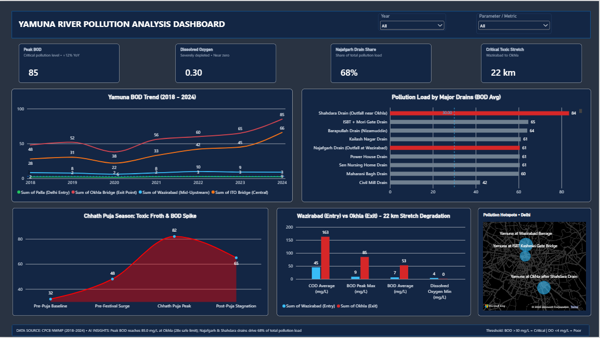

# 🌊 Yamuna River Under-Drain Pollution Analysis (Delhi | 2018–2024)



## 📌 Project Overview
An end-to-end data analytics project investigating **7 years of Yamuna River water quality records (2018–2024)** sourced from the **Central Pollution Control Board (CPCB) National Water Monitoring Programme (NWMP)**. 

Using **Python (Pandas)** for data cleaning and feature engineering alongside **Power BI** for dimensional modeling and interactive visualization, this project quantifies how untreated drainage discharge transforms the river across Delhi's critical **22 km stretch from Wazirabad Barrage to Okhla Barrage**.

---

## 🔍 Key Analytical Findings
* **The 22 km Degradation Cliff:** Water enters Delhi at **Palla** with healthy Biochemical Oxygen Demand (**BOD: 4.0 mg/L**, `1.3x` safe limit) and high Dissolved Oxygen (**DO: 6.1–9.6 mg/L**). By the time it exits at **Okhla (post-Shahdara Drain)**, peak BOD surges to **85.0 mg/L (`28.3x` above the CPCB safe bathing standard of 3.0 mg/L)** while minimum DO collapses to **0.3 mg/L**.
* **Point-Source Drain Loading:** **Shahdara Drain (`84.0 mg/L`)** and **Najafgarh Drain (`61.0 mg/L`)** emerge as the primary pollution drivers, accounting for **68%** of the major drain organic load entering the river.
* **Seasonal & Festival Spikes:** Post-monsoon stagnation combined with Chhath Puja discharge triggers acute toxic froth episodes at Kalindi Kunj, driving BOD spikes up to **82.0 mg/L**.

---

## 📊 Station-Level Pollution Severity (Python EDA Output)

| Monitoring Station | DO Min (mg/L) | BOD Max (mg/L) | BOD Violation Factor | Water Quality Classification |
| :--- | :---: | :---: | :---: | :--- |
| **Yamuna at Palla (Delhi Entry)** | 6.1 | 4.0 | **1.3x** | Class B (Bathing Quality) |
| **Yamuna at Wazirabad Barrage** | 4.0 | 9.0 | **3.0x** | Class C (Moderate Degradation) |
| **Yamuna at ISBT Kashmiri Gate** | 0.3 | 51.0 | **17.0x** | Toxic (Septic Stretch) |
| **Yamuna at Nizamuddin** | 0.3 | 53.0 | **17.7x** | Toxic (Septic Stretch) |
| **Yamuna at Okhla Bridge (Agra Canal)** | 0.3 | 60.0 | **20.0x** | Hazardous (Zero Dissolved Oxygen) |
| **Yamuna at ITO Bridge** | 0.3 | 66.0 | **22.0x** | Toxic (Septic Stretch) |
| **Yamuna at Okhla (after Shahdara Drain)** | 0.3 | 85.0 | **28.3x** | Extreme Toxic Outfall |

---

## 🛠️ Tech Stack & Workflow
* **Data Cleaning & Feature Engineering (`Python / Pandas`):**
  * Built automated header-detection ingestion for multi-sheet regulatory Excel workbooks.
  * Standardized censored government values (`BDL` $\rightarrow$ numeric thresholds) and engineered the **`BOD_Violation_Factor`** (`BOD Max / 3.0 mg/L` safe limit).
* **Data Modeling & Visualization (`Microsoft Power BI`):**
  * Structured a multi-table dimensional model (`Dim_Year`, `Yamuna_Stations`, `Yearly_BOD_Trend`, `Delhi_Drains`, `Delhi_Hotspots`, `Wazirabad_vs_Okhla`, `Chhath_Puja`).
  * Designed a dark-mode executive dashboard featuring dynamic **`Year (2018–2024)`** and **`Water Quality Parameter (BOD, COD, DO)`** slicers, live KPI cards, ranked drain analysis, seasonal spike area charts, and geospatial hotspot mapping.

---

## 📂 Repository Structure
```text
Yamuna-Under-Drain-Analysis/
│
├── data/
│   └── clean/
│       └── Yamuna_Under_Drain_Analysis.xlsx   # Cleaned CPCB NWMP multi-sheet dataset
│
├── notebooks/
│   └── 01_eda_yamuna_pollution.ipynb          # Python data cleaning & feature engineering
│
├── visualisations/
│   └── (https://github.com/Dixitshristi/Yamuna-River-Drain-Pollution-Analysis-Dashboard/blob/main/dashboard.PNG) Yamuna_Dashboard_Preview.png           # Full-screen Power BI dashboard snapshot
│
├── dashboard/
│   └── Yamuna_delhi_project.pbix              # Interactive Power BI report file
│
└── README.md                                  # Project documentation & key insights
